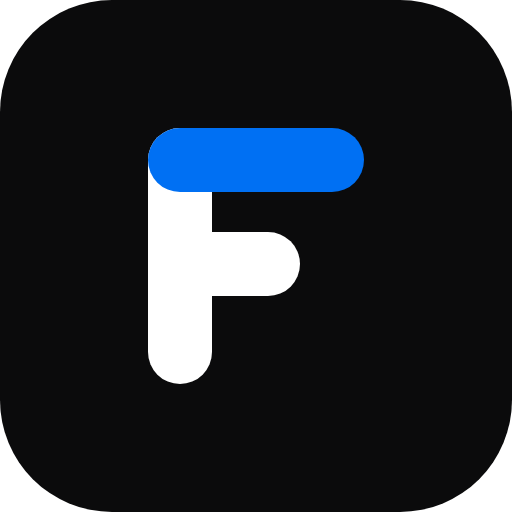

# Fora

**简洁、快速的会议日程浏览器——浏览每一场议程，标记你在意的内容，让日程在所有设备间同步。**

[English](README.md) · 中文

Fora 把密集的会议日程变得真正好用。挑选一个会议，浏览它的议程，通过给感兴趣的内容加星来构建你的个人日程，并把它随身带到每一台设备上——无需安装任何应用。

## 功能

- 🏛️ **多会议，一个站点**——浏览 CCF Chip 2026、ChinaOSC 2026、ChinaSoft 2025 与 ChinaSoft 2026。
- 🗓️ **完整的会议内容**——主旨报告、并行分会场、讲者、委员会与组织机构，界面支持中英双语，会议内容保留来源语言；时间视图把同时进行的会场并排呈现。
- 🔴 **会期当天的现场视图**——此刻每个会场在进行什么、下一场何时开始、你加星的下一场还有多久；即使设备位于其他时区，也按会议当地时间显示。
- 📅 **跨日会场**——收藏一次会场，各场报告按实际日期进入日程、提醒和日历导出。
- 📖 **来源资料**——展示官网照片、主持人与茶歇，来源矛盾可展开查看，未公布的议程明确保留待定状态。
- ⭐ **专属日程**——给在意的报告、会场和讲者加星，「我的一天」再把一天读成一份计划：空闲的间隔、要换的会场，以及需要你取舍的冲突。
- 🔔 **提醒**——可选开启，在你加星的每一场开始前提醒你。
- 🔍 **全站搜索**——一个搜索框，覆盖报告标题与摘要、讲者、单位、会场、委员会与组织机构。
- 🧭 **为我规划**——依据你的兴趣，排出一份不冲突的日程，并说明每一场是怎么选出来的。
- 🗺️ **主题地图**——一张看清会议在讲什么的图，以及每场报告的「相似报告」。
- ✨ **AI 摘要，由你决定**——一句话概要与主题标签，均标注为 AI 生成，且由一个总开关控制；原文始终触手可及。
- 🔄 **多设备同步**——登录即可让日程在各设备间保持同步；仅浏览无需登录。
- 📲 **安装与离线**——添加到设备后，断网也能继续使用。
- 📤 **导出与备份**——把日程导入你的日历，或导出为可再次导入的备份。
- 🖼️ **分享**——一键把任意会场或报告生成一张简洁的分享图片。
- 🌗 **浅色与深色**——跟随系统。无任何追踪。

## 开发

Fora 是开源项目。本地运行、参与贡献或新增会议，请见 **[AGENTS.md](AGENTS.md)**。

会议数据独立发布到 Cloudflare R2；应用由 Workers 托管，登录会话和收藏同步存储在 D1。
报告重排后，收藏与链接仍保持稳定。生成的会议 JSON 不进入 Git，原始资料和构建脚本
用于重建本地测试数据。2026 年 10 月 29 日已清理 Git 历史，旧克隆请先保存本地工作，
再重新克隆。部署与发布流程见 [说明](cloudflare/README.md)。

## 许可证

[MIT](LICENSE) © Super Lee & Claude。
